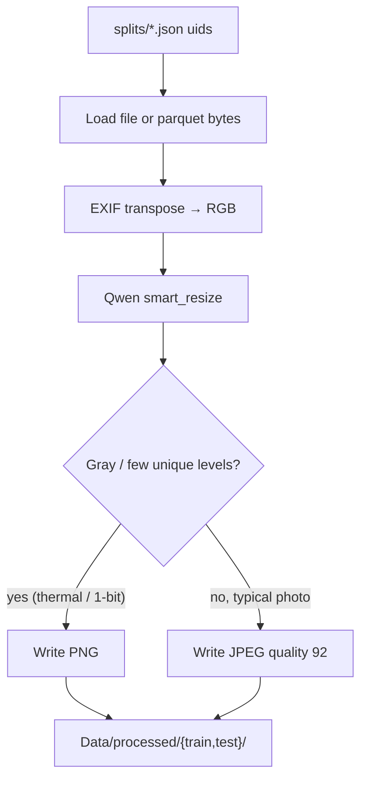

# IE643 — receipt / invoice information extraction

Student distillation project: a **Qwen3-VL-32B** teacher labels receipt and invoice images into a shared JSON schema, then a smaller **Qwen2.5-VL** student is trained on those labels (attention rollout comes later).

The raw dump under `Data/` is ~80k images across 12 sources. Training and eval use a **narrowed, leakage-safe subset** only (seed 643). Russian receipts are out of this pool.

| Dataset                      | Official split       |                              Train |                           Test | Notes                                                                                                                                                                                     |
| ---------------------------- | -------------------- | ---------------------------------: | -----------------------------: | ----------------------------------------------------------------------------------------------------------------------------------------------------------------------------------------- |
| ICDAR-2019 SROIE (task 3)    | train / test         |                                727 |                            347 | 8 train jpgs without JSON GT dropped                                                                                                                                                      |
| FATURA                       | train / dev / test   |                               7500 |                           2500 | **dev merged into test**                                                                                                                                                            |
| CORD-v2                      | train / val / test   |                                800 |                            200 | **val merged into test**                                                                                                                                                            |
| synthetic-receipts-ocr       | train / eval         | 7000 (3000 IT + 3000 FR + 1000 EN) | 798 (327 IT + 271 FR + 200 EN) | Train from official train. Test target was 20% (600/600/200) from official eval; eval only has 327 IT and 271 FR, so those are used in full rather than stealing train images. EN = US+UK |
| invoices-and-receipts_ocr_v2 | train / valid / test |                               2843 |                            395 | All official train (needed 3973 to reach 20k overall; v2 only has 2843). Test is 20% of that train count, capped at official valid∪test (395)                                            |
| **Total**              |                      |                    **18870** |                 **4240** | Target train was 20 000; short 1130 because v2 official train is exhausted. Do not fill from val/test.                                                                                   |

Validation is never mixed into train. Train images are never sampled from test/val/eval.

Frozen JSON (uids, image pointers, canonical `source_gt`) lives at the repo root so the team can share it without touching `Data/`:

```
splits/index.json
splits/sroie.json
splits/fatura2.json
splits/cord-v2.json
splits/synthetic-receipts-ocr.json
splits/invoices-and-receipts-v2.json
```

Images themselves stay under `Data/` (gitignored). Records point at files or parquet `(path, column, row_index)` relative to `/backup/Anshul/IE643/Data`. Team members should read these JSON files and not resample.

## Setup

```bash
uv sync
# vLLM compiles CUDA kernels; needs Python headers
# sudo apt install python3.12-dev
```

Python 3.10+ (this box uses 3.12). GPU: two NVIDIA GPUs for tensor parallel 2 (the 32B teacher).

## Canonical schema

Teacher, human review, and the student all use the same keys (`ie643.schema.FIELD_ORDER`): vendor, address, tax id, dates, currency, line items, totals, payment, etc. A field is non-null only if it is printed. Dates and numbers stay in printed form.

## Frozen splits (no leakage)

Rebuild only if the protocol changes (same seed → same uids):

```bash
python -m ie643.splits --out splits --seed 643
```

Each `*.json` has `train` / `test` arrays. Every record has:

- `uid` — globally unique (`dataset::…`); CORD and v2 reuse a local `image_id`/`id` per official split, so the uid always includes `source_split` and (for parquet) `row_index`
- `split` — `train` or `test` (assigned)
- `source_split` — original publisher split (`train` / `val` / `test` / `eval`)
- `image` — `{kind: file, path: …}` relative to `Data/`, or `{kind: parquet, path, column, row_index}`
- `source_gt` — canonical JSON from the dataset adapter

`leakage_audit` in each file must show `uid_overlap: 0` and `locator_overlap: 0`. Train `source_split` is only `train`; test is only val/test/eval.

English synthetic locales are **US + UK**. Italian = `IT`, French = `FR`.

## Image pack (canonical pixels)

Teacher and student must see **the same pixels**. `python -m ie643.pack` walks **only** the uids in `splits/*.json`, loads the original file or parquet row, applies Qwen `smart_resize`, and writes a frozen JPEG/PNG plus `manifest.jsonl`.

Do **not** use `python -m ie643.preprocess` for this pool. That CLI walks publisher iterators and will mix the wrong split.

Russian binary paper-crop is gone. Nothing else is deskewed, binarized, or inpainted.



**Why resize here, not inside vLLM?** vLLM would resize again from the original, and a later student trainer might use a different default. Saving the resized file once makes teacher, review UI, and student load identical tensors.

### Qwen `smart_resize`

Same contract as `qwen_vl_utils.vision_process` (Qwen2.5-VL / Qwen3-VL):

| Constraint     | Value                              | Meaning                                                                   |
| -------------- | ---------------------------------- | ------------------------------------------------------------------------- |
| Patch / factor | 28                                 | Height and width are multiples of 28 (one vision token is a 28×28 patch) |
| Min pixels     | `4 × 28 × 28` = 3 136         | Tiny receipts are scaled up so the encoder is not starved                 |
| Max pixels     | `1280 × 28 × 28` = 1 003 520 | Cap ≈ 1280 visual tokens (~1.0 MP) so a 32B TP=2 serve fits              |
| Max aspect     | 200                                | Rejects pathological strips                                               |

If `H×W` is above the cap, both sides scale by `sqrt((H×W) / max_pixels)` and then snap down to a multiple of 28. Below the floor, they scale up the same way. LANCZOS is used for the actual resample.

A 3000×4000 photo therefore does **not** go to the teacher at full resolution; a 200×400 crop is scaled **up**. The manifest stores both sizes: `orig_width` / `orig_height` (before) and `width` / `height` (after).

### Process train and test

Always pack **test** and **train** as separate folders so a student benchmark cannot see train images.

```bash
# test first (4240 images) — base teacher vs student F1 vs source_gt
python -m ie643.pack --split test --out Data/processed/test --splits splits

# train (18870 images) — teacher hard labels (+ later soft labels)
python -m ie643.pack --split train --out Data/processed/train --splits splits
```

`--resume` skips uids that already have a file. `--limit N` is only for a smoke test. `--datasets sroie,cord-v2` packs a subset.

On disk:

```
Data/processed/test/
  pack.json
  canonical_schema.json
  manifest.jsonl
  manifests/<dataset>.jsonl
  images/<dataset>/<uid>.jpg|png

Data/processed/train/     # same layout, train uids only
```

Each manifest row keeps `source_gt`, empty `teacher_gt` / `student_pred`, and `split` (`train` or `test`).

## Teacher / student extraction with vLLM

Same prompt and parser for both models. Predictions go into **different keys** so a student run cannot overwrite teacher JSON.

### 1. Start vLLM (one model at a time on :8000)

Teacher (32B, TP=2):

```bash
export VLLM_USE_FLASHINFER_SAMPLER=0   # FlashInfer cannot read SM 12.0 here

.venv/bin/vllm serve Qwen/Qwen3-VL-32B-Instruct \
  --tensor-parallel-size 2 \
  --max-model-len 16384 \
  --gpu-memory-utilization 0.85
```

Student (~3B; stop the teacher first):

```bash
export VLLM_USE_FLASHINFER_SAMPLER=0
.venv/bin/vllm serve Qwen/Qwen2.5-VL-3B-Instruct \
  --max-model-len 16384 \
  --gpu-memory-utilization 0.5
```

Wait until `Application startup complete`, then `curl -s http://127.0.0.1:8000/v1/models`.

### 2. Test-only extract (base benchmark)

Score these JSON fields against `source_gt`, not against each other.

```bash
# teacher → teacher_gt (default --pred-key)
python -m ie643.teacher \
  --manifest Data/processed/test/manifest.jsonl \
  --model Qwen/Qwen3-VL-32B-Instruct \
  --pred-key teacher_gt \
  --repetition-penalty 1.15 \
  --max-tokens 4096

# student → student_pred (does not touch teacher_gt)
python -m ie643.teacher \
  --manifest Data/processed/test/manifest.jsonl \
  --model Qwen/Qwen2.5-VL-3B-Instruct \
  --pred-key student_pred \
  --repetition-penalty 1.15 \
  --max-tokens 4096

# teacher vs source_gt (same command with --pred-key student_pred for the student)
python -m ie643.eval \
  --manifest Data/processed/test/manifest.jsonl \
  --pred-key teacher_gt
```

Only fields that `source_gt` filled are scored (SROIE-style). List rows match on name/label + amount; quantity, unit price, and tax rate count only when both sides filled them (`0.055` equals `5,5%`). Extra predicted lines with amount 0 are ignored. The `tax` scalar matches a VAT band or the sum of bands. `--strict` counts extras as false positives; `--count-missing` treats unlabeled rows as empty preds.

### 3. Train extract (distillation labels)

Same CLI, train pack only. Add top-k logprobs later on this pass so the 32B teacher is not run twice.

```bash
python -m ie643.teacher \
  --manifest Data/processed/train/manifest.jsonl \
  --model Qwen/Qwen3-VL-32B-Instruct \
  --pred-key teacher_gt \
  --repetition-penalty 1.15
```

Behavior:

- Skips rows that already have `--pred-key` set unless `--overwrite`
- `--errors-only` retries failed rows for that pred key
- `--uids a,b,c` runs a subset
- Checkpoints the jsonl every 10 images and writes per-dataset shards under `manifests/`
- Sampling: temperature 0, `response_format=json_object`, `repetition_penalty=1.15` (do **not** use frequency penalty — it breaks JSON quotes). vLLM `repetition_detection` stops zero-loops on noisy scans.
- Parse does **not** fall back to `source_gt` (that would leak GT into a benchmark)

### 4. Review (optional)

```bash
python -m ie643.review --root Data/processed/test
# http://127.0.0.1:8765
```

### 5. Attention rollout (which pixels each field came from)

Decoder-level rollout over each model's **own stored output** (`teacher_raw` / `student_raw`). One teacher-forced forward pass in HF transformers (eager attention; vLLM cannot return attention), so stop vLLM first. The 32B teacher spreads over both GPUs.

```bash
U="cord::test:35,sroie::X51006620437"   # comma-separated test uids that have the raw key
CUDA_VISIBLE_DEVICES=0 python -m ie643.rollout run --model Qwen/Qwen2.5-VL-3B-Instruct --raw-key student_raw --tag student --uids "$U"
python -m ie643.rollout run --model Qwen/Qwen3-VL-32B-Instruct --raw-key teacher_raw --tag teacher --uids "$U"
python -m ie643.rollout report            # -> Data/rollout/report/
python -m ie643.rollout report --key rollout_full   # ablation: classic full-matrix rollout
```

- **Sinks are excluded** before rolling out. Everything before the first image token counts as a sink (`<|im_start|>`, Qwen2.5's system prompt): ~30–50% of raw attention goes there, and causal rollout otherwise collapses onto position 0. Image tokens with massive activations also count (`--sink-ratio 10` × the image-token median); Qwen3-VL has 1–4 of these per page, marked × in the figures.
- **`rollout`** (main) propagates only through generated tokens and treats prompt/image positions as leaves. `rollout_full` is the classic N×N product; it collapses onto the earliest kept token and is only an ablation.
- Per-field maps average the rollout rows that predicted that JSON value's tokens. Teacher (32 px tokens) and student (28 px) maps are compared after resampling to one grid.
- Outputs: `docs/<uid>.png` (input | all values | vendor | date | total, ✓/✗ vs `source_gt`), `image_share.png`, `area50.png`, `layer_profile.png`, `field_metrics.csv`, `agreement.csv`, `summary.json`.

## Student demo (Hugging Face Space)

`space/` is a Gradio app: upload a receipt, get the shared JSON. It loads `Qwen/Qwen2.5-VL-3B-Instruct` unless `STUDENT_MODEL` is set, so the distilled checkpoint is a variable change, not a code change. Same prompt as the teacher (`ie643.schema.teacher_prompt`) when the Space is run from this repo.

Needs a GPU Space (T4 or ZeroGPU). Do not point the Space at this whole repo's `requirements`; publish the `space/` folder as the Space root.

```bash
huggingface-cli upload <user>/ie643-student space . --repo-type space
```

## Layout

```
src/ie643/
  schema.py           # canonical keys + teacher prompt
  preprocess/         # adapters, Qwen resize (legacy iterators)
  pack/               # frozen train/test image packs from splits/
  splits/             # uid JSON builder
  teacher/            # vLLM OpenAI client + parse/repair
  eval/               # teacher/student vs source_gt
  rollout/            # decoder attention rollout + report figures
  review/             # HTML review UI
space/                # Gradio demo for the student (HF Space)
splits/               # team train/test JSON (this repo)
Data/processed/test/  # packed test images + manifest
Data/processed/train/ # packed train images + manifest
```

## Reproducibility

Split seed is **643**. Re-running `python -m ie643.splits --out splits --seed 643` must keep `leakage_audit.uid_overlap == 0`. Pack only from those uids. Do not fine-tune on `split=test`.
