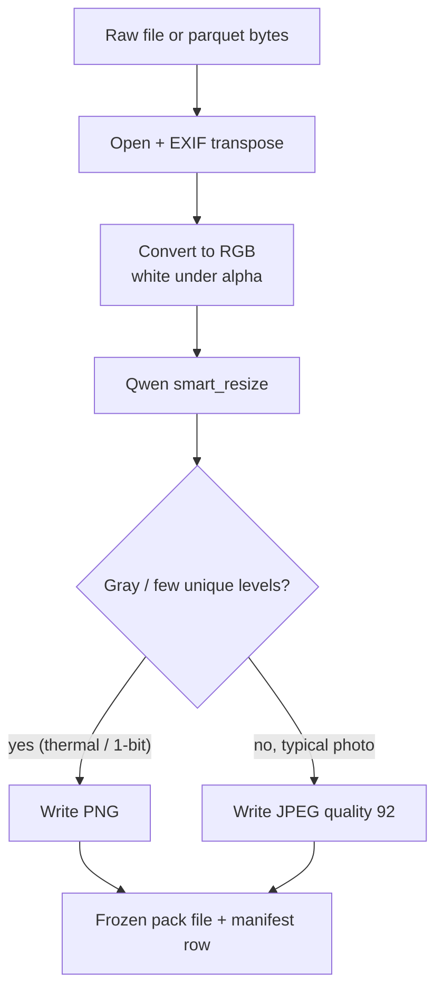
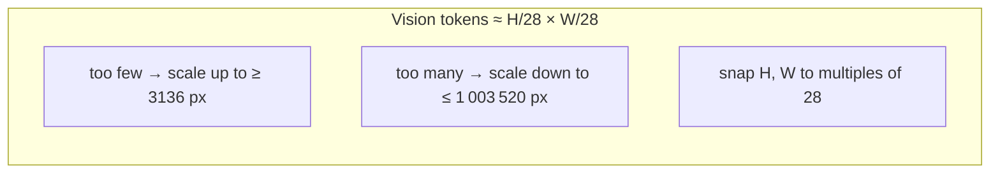

# IE643 — receipt / invoice information extraction

Student distillation project: a **Qwen3-VL-32B** teacher labels receipt and invoice images into a shared JSON schema, then a smaller **Qwen2.5-VL** student is trained on those labels (attention rollout comes later).

The raw dump under `Data/` is ~80k images across 12 sources. Training and eval use a **narrowed, leakage-safe subset** only (seed 643). Russian receipts are out of this pool.


| Dataset                      | Official split       | Train                              | Test                           | Notes                                                                                                                                                                                     |
| ---------------------------- | -------------------- | ---------------------------------- | ------------------------------ | ----------------------------------------------------------------------------------------------------------------------------------------------------------------------------------------- |
| ICDAR-2019 SROIE (task 3)    | train / test         | 727                                | 347                            | 8 train jpgs without JSON GT dropped                                                                                                                                                      |
| FATURA                       | train / dev / test   | 7500                               | 2500                           | **dev merged into test**                                                                                                                                                                  |
| CORD-v2                      | train / val / test   | 800                                | 200                            | **val merged into test**                                                                                                                                                                  |
| synthetic-receipts-ocr       | train / eval         | 7000 (3000 IT + 3000 FR + 1000 EN) | 798 (327 IT + 271 FR + 200 EN) | Train from official train. Test target was 20% (600/600/200) from official eval; eval only has 327 IT and 271 FR, so those are used in full rather than stealing train images. EN = US+UK |
| invoices-and-receipts_ocr_v2 | train / valid / test | 2843                               | 395                            | All official train (needed 3973 to reach 20k overall; v2 only has 2843). Test is 20% of that train count, capped at official valid∪test (395)                                             |
| **Total**                    |                      | **18870**                          | **4240**                       | Target train was 20 000; short 1130 because v2 official train is exhausted. Do not fill from val/test.                                                                                    |


Validation is never mixed into train. Train images are never sampled from test/val/eval.

Frozen JSON (uids, image pointers, canonical `source_gt`) lives at the repo root so the team can share it without touching `Data/`:

```
splits/index.json
splits/sroie.json
splits/fatura2.json
splits/cord-v2.json
splits/synthetic-receipts-ocr.json
splits/invoices-and-receipts-v2.json
```

Images themselves stay under `Data/` (gitignored). Records point at files or parquet `(path, column, row_index)` relative to `/backup/Anshul/IE643/Data`. Team members should read these JSON files and not resample.

## Setup

```bash
uv sync
# vLLM compiles CUDA kernels; needs Python headers
# sudo apt install python3.12-dev
```

Python 3.10+ (this box uses 3.12). GPU: two NVIDIA GPUs for tensor parallel 2 (the 32B teacher).

## Canonical schema

Teacher, human review, and the student all use the same keys (`ie643.schema.FIELD_ORDER`): vendor, address, tax id, dates, currency, line items, totals, payment, etc. A field is non-null only if it is printed. Dates and numbers stay in printed form.

## Frozen splits (no leakage)

Rebuild only if the protocol changes (same seed → same uids):

```bash
python -m ie643.splits --out splits --seed 643
```

Each `*.json` has `train` / `test` arrays. Every record has:

- `uid` — globally unique (`dataset::…`); CORD and v2 reuse a local `image_id`/`id` per official split, so the uid always includes `source_split` and (for parquet) `row_index`
- `split` — `train` or `test` (assigned)
- `source_split` — original publisher split (`train` / `val` / `test` / `eval`)
- `image` — `{kind: file, path: …}` relative to `Data/`, or `{kind: parquet, path, column, row_index}`
- `source_gt` — canonical JSON from the dataset adapter

`leakage_audit` in each file must show `uid_overlap: 0` and `locator_overlap: 0`. Train `source_split` is only `train`; test is only val/test/eval.

English synthetic locales are **US + UK**. Italian = `IT`, French = `FR`.

## Image pack (canonical pixels)

Teacher logits and student distillation must see **the same pixels**. The image pack is that freeze: one RGB file per receipt, resized with the same rule Qwen-VL uses at inference.

Russian binary paper-crop is gone (that dataset is not in this pool). Nothing else is deskewed, binarized, or inpainted.




**Why resize here, not inside vLLM?** vLLM would resize again from the original, and a later student trainer might use a different default. Saving the resized file once makes teacher, review UI, and student load identical tensors.

### Qwen `smart_resize`

Same contract as `qwen_vl_utils.vision_process` (Qwen2.5-VL / Qwen3-VL):


| Constraint     | Value                        | Meaning                                                                  |
| -------------- | ---------------------------- | ------------------------------------------------------------------------ |
| Patch / factor | 28                           | Height and width are multiples of 28 (one vision token is a 28×28 patch) |
| Min pixels     | `4 × 28 × 28` = 3 136        | Tiny receipts are scaled up so the encoder is not starved                |
| Max pixels     | `1280 × 28 × 28` = 1 003 520 | Cap ≈ 1280 visual tokens (~1.0 MP) so a 32B TP=2 serve fits              |
| Max aspect     | 200                          | Rejects pathological strips                                              |


If `H×W` is above the cap, both sides scale by `sqrt((H×W) / max_pixels)` and then snap down to a multiple of 28. Below the floor, they scale up the same way. LANCZOS is used for the actual resample.

A 3000×4000 photo therefore does **not** go to the teacher at full resolution; a 200×400 crop is scaled **up**. The manifest stores both sizes: `orig_width` / `orig_height` (before) and `width` / `height` (after).




### What a pack looks like on disk

```
Data/processed/<pack>/
  images/<dataset>/<uid>.jpg|png
  manifest.jsonl              # one row per image
  manifests/<dataset>.jsonl   # same rows, sharded
```

Each manifest row points at the frozen file (`image`), keeps `source_gt` from the dataset adapter, and leaves `teacher_gt` empty until vLLM fills it.

for the narrowed five datasets, drive inference from `splits/*.json` uids so test receipts are not trained on.

```bash
python -m ie643.preprocess \
  --datasets sroie,fatura2,cord-v2,synthetic-receipts-ocr,invoices-and-receipts-v2 \
  --out Data/processed/teacher_narrow \
  --seed 643
```

That CLI still walks publisher iterators (not the frozen JSON). Use the `uid` lists in `splits/` as the allow-list when you materialize the training pack so train/test cannot mix.

## Teacher inference with vLLM

The teacher is **Qwen3-VL-32B-Instruct** served by vLLM’s OpenAI-compatible API. Start the server **once**, then run the CLI against a manifest of images.

### 1. Start vLLM

On this dual-GPU box (Blackwell / SM 12.0):

```bash
export VLLM_USE_FLASHINFER_SAMPLER=0   # FlashInfer cannot read SM 12.0 here

.venv/bin/vllm serve Qwen/Qwen3-VL-32B-Instruct \
  --tensor-parallel-size 2 \
  --max-model-len 16384 \
  --gpu-memory-utilization 0.85
```

`--gpu-memory-utilization 0.85` leaves room if other jobs still hold a few GB per GPU. Drop to `0.75` if you OOM at startup.

Wait until the log shows `Application startup complete`. Check:

```bash
curl -s http://127.0.0.1:8000/v1/models
```

### 2. Run the teacher

```bash
python -m ie643.teacher \
  --manifest Data/processed/teacher100/manifest.jsonl \
  --base-url http://127.0.0.1:8000/v1 \
  --model Qwen/Qwen3-VL-32B-Instruct \
  --repetition-penalty 1.15 \
  --max-tokens 4096
```

Behavior:

- Skips rows that already have `teacher_gt` unless `--overwrite`
- `--errors-only` retries `status=teacher_error`
- `--uids a,b,c` runs a subset
- Checkpoints the jsonl every 10 images and writes per-dataset shards under `manifests/`
- Sampling: temperature 0, `response_format=json_object`, `repetition_penalty=1.15` (do **not** use frequency penalty — it breaks JSON quotes). vLLM `repetition_detection` stops zero-loops on noisy scans.

### 3. Review (optional)

```bash
python -m ie643.review --root Data/processed/teacher100
# http://127.0.0.1:8765
```

## Layout

```
src/ie643/
  schema.py           # canonical keys + teacher prompt
  preprocess/         # adapters, Qwen resize, dataset iterators
  splits/             # frozen train/test JSON builder
  teacher/            # vLLM OpenAI client + parse/repair
  review/             # HTML review UI
splits/               # team train/test JSON (this repo)
Data/                 # gitignored images + processed packs
```

## Reproducibility

Split seed is **643**. Re-running `python -m ie643.splits --out splits --seed 643` must keep `leakage_audit.uid_overlap == 0`. Do not shuffle train and test together and do not fine-tune on `split=test`.